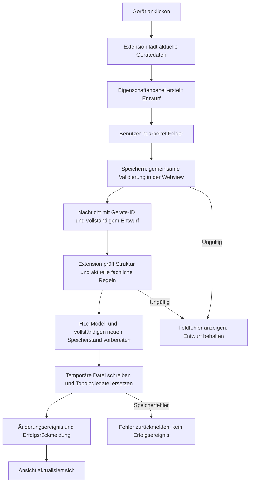

# Dokumentationsvorlage für H2c – Auswahl, Bearbeitung und Konfiguration von Geräten

Diese Vorlage beschreibt den implementierten Stand. Die Abschnitte zur Umsetzung
können als Grundlage für die Projektdokumentation verwendet werden. Die Tabellen
für manuelle Tests und Review müssen nach der tatsächlichen Durchführung ergänzt werden.

## 1. Aufgabe und Dokumentstand festhalten

| Angabe | Stand |
| --- | --- |
| Teilziel | H2c – Auswahl/Bearbeitung/Konfiguration von Geräten |
| Jira-Ticket | SCRUM-30 |
| Projekt | TopoCheck – Visual-Studio-Code-Extension |
| Bearbeiter/in | [Name ergänzen] |
| Dokumentationsdatum | 29.10.2026; bei späteren Änderungen aktualisieren |
| Entwicklungsbranch | `feature/h2c-device-configuration` |
| Ausgangsstand | `main`, Commit `b1b835b` |
| Beschriebener Implementierungsstand | Commit `c8569bb` |
| GitHub-Stand bei Erstellung | Sieben lokale Commits vor dem Remote-Feature-Branch; noch nicht gepusht |

Für spätere Testnachweise immer den tatsächlich getesteten Commit angeben:

```powershell
git branch --show-current
git rev-parse --short HEAD
git status --short
```

## 2. Ziel und Ausgangssituation beschreiben

**Textvorschlag:**

Ziel von H2c war die Entwicklung einer Benutzeroberfläche zur Auswahl, Bearbeitung
und Konfiguration von Netzwerkgeräten innerhalb der Topologieansicht. Die Eingaben
sollten geprüft, an das Netzwerkmodell aus H1c übergeben und dauerhaft gespeichert
werden. Ungültige Angaben sollten verständlich angezeigt werden.

Zu Beginn waren das Erstellen, Auswählen, Verschieben, Umbenennen und Löschen von
Geräten sowie Kabelverbindungen bereits vorhanden. Der Einstieg `openDevice()` war
vorbereitet, führte jedoch noch zu keinem vollständigen Konfigurationsformular.
Außerdem verwendete die Topologieoberfläche eigene gespeicherte Datenstrukturen,
während H1c Klassen für Netzwerkgeräte, Interfaces und Protokolle bereitstellte.
Für H2c musste deshalb auch die Verbindung zwischen Oberfläche, Speicherung und
H1c-Modell umgesetzt werden.

## 3. Anforderungen und Abgrenzung dokumentieren

Die vier Acceptance Criteria aus SCRUM-30:

| ID | Anforderung |
| --- | --- |
| AC1 | Ein Auswahlfenster öffnet sich beim Klick auf ein Gerät. |
| AC2 | Pflichtfelder sind visuell erkennbar und werden vor der Übernahme validiert. |
| AC3 | Eingaben werden korrekt an das H1c-Datenmodell übergeben. |
| AC4 | Fehlerhafte Eingaben werden mit einer verständlichen Meldung abgelehnt. |

Zur Aufgabe gehören das Eigenschaftenpanel, die Konfiguration vorhandener
Interfaces, die Auswahl unterstützter Protokolle, Validierung, Modellabbildung
und Speicherung. Eine vollständige Cisco-Konfigurationsgenerierung sowie die
detaillierte Konfiguration sämtlicher Routingprotokolle wurden nicht umgesetzt.
Die Parser-Output-Vorschau ist eine separate Funktion und kein Abnahmekriterium
für dieses Teilziel.

## 4. Oberfläche und Bedienung beschreiben

**Textvorschlag:**

Die Gerätekonfiguration wurde als rechtes Eigenschaftenpanel in die bestehende
Webview integriert. Die visuelle Gestaltung orientiert sich an der bereitgestellten
Referenz: Geräteinformationen stehen im Kopfbereich, darunter folgen kompakte
Eingabefelder und einzelne Interface-Karten. Die Darstellung verwendet die
Farben des aktuellen VS-Code-Themes.

Ein einfacher Klick auf ein Gerät öffnet das Panel mit den gespeicherten Werten.
Der vorhandene Konfigurationseinstieg, die Enter-Taste auf dem ausgewählten Gerät
und der Kontextmenüeintrag führen ebenfalls dorthin. Beim Verschieben wird das
Formular nicht geöffnet. Im Kabelmodus bleibt die Auswahl der Kabelendpunkte
zuständig für den Geräteklick.

### 4.1 Vorhandene Felder

| Bereich | Felder und Funktion |
| --- | --- |
| Gerät | Name/Label und Hostname getrennt bearbeiten; Gerätetyp anzeigen |
| Zugang | Domain-Name, Benutzername, Enable Secret, Console-Passwort, VTY-Passwort |
| Hinweistext | Mehrzeiliger Banner |
| Interfaces | IPv4-Adresse, Subnetzmaske, Beschreibung, aktiviert/deaktiviert |
| Protokolle | Für den Gerätetyp unterstützte Protokolle auswählen und aktivieren/deaktivieren |
| Aktionen | Speichern, Abbrechen, Schließen |

Name/Label und Hostname sind mit `*` gekennzeichnet. Der Hinweis
„* Pflichtfeld · Weitere Angaben optional“ erklärt die Kennzeichnung. Diese
gemeinsame Kennzeichnung wurde als ausreichend akzeptiert.

Das Label ist die sichtbare Bezeichnung in der Zeichnung. Der Hostname ist eine
eigene Netzwerkkonfigurationsangabe. Beide Werte werden getrennt gespeichert.

### 4.2 Interfaceanzeige und automatische Aktivierung

- Standardmäßig erscheinen nur Interfaces, die verbunden und aktiviert sind.
  „In Nutzung“ bezeichnet hier diesen Zustand; Netzwerkverkehr wird nicht gemessen.
- „Alle Interfaces anzeigen“ blendet auch freie oder deaktivierte Ports ein.
- Ein kurzer Text unter der Auswahl erklärt den aktuellen Filter.
- Der Filter verändert keine gespeicherte Konfiguration. Eingaben bleiben beim
  Aus- und Einblenden erhalten.
- Neue Ports starten deaktiviert. Beim Erstellen einer Kabelverbindung werden
  beide Endpunkte aktiviert. Beim Trennen oder Löschen des Gegenübers werden die
  betroffenen verbleibenden Ports deaktiviert.
- Eine ausdrücklich gespeicherte manuelle Deaktivierung bleibt beim Laden erhalten.
- Bei einem Fehler an einem ausgeblendeten Port werden alle Interfaces eingeblendet
  und das fehlerhafte Feld fokussiert.

Die zwischenzeitlich vorhandene Layer-2/3-Auswahl wurde auf Wunsch entfernt.
Vorhandene Layer-Werte bleiben intern erhalten und werden beim Speichern nicht
durch eine neue Auswahl verändert.

### 4.3 Entwurf, Speichern und Abbrechen

Eingaben bleiben zunächst als Entwurf in der Webview. Erst „Speichern“ übermittelt
die vollständige Konfiguration an die Extension. Während des Speicherns sind die
Bedienelemente gesperrt. Bei einer Fehlermeldung bleibt der Entwurf erhalten.

„Abbrechen“ verwirft die Eingaben. Beim Schließen, bei Escape oder beim Wechsel
zu einem anderen Gerät wird bei ungespeicherten Änderungen nachgefragt. Man kann
verwerfen oder weiter bearbeiten.

Passwortfelder werden maskiert dargestellt. Die Angaben sind Bestandteil der
lokalen Topologiedatei; eine verschlüsselte Speicherung ist nicht implementiert.
Der Modell-Inspektionsbefehl zeigt nur an, ob Passwörter gesetzt sind. Für die
Dokumentation ausschließlich Beispielwerte verwenden.

## 5. Technische Umsetzung erklären

### 5.1 Zuständigkeiten

| Datei | Zuständigkeit |
| --- | --- |
| `src/webview/deviceConfigurationForm.ts` | Eigenschaftenpanel, Entwurf, Filter, Feldfehler, Speichern und Abbrechen |
| `src/webview/editor.ts` | Geräteklick, Ziehen und Kabelmodus |
| `src/webview/main.ts` | Einbindung des Panels und Verteilung der Extension-Nachrichten |
| `src/shared/protocol.ts` | Typen für Nachrichten zwischen Webview und Extension |
| `src/modules/topology/view/parseWebviewMessage.ts` | Prüfung der Nachrichtenstruktur |
| `src/modules/topology/view/TopologyViewPanel.ts` | Öffnen des Panels, Bearbeiten von Nachrichten und Rückmeldungen |
| `src/shared/deviceConfiguration.ts` | Konfigurationsentwurf und Abbildung auf H1c-Objekte |
| `src/shared/validateDeviceConfiguration.ts` | Gemeinsame fachliche Validierung mit Feldfehlern |
| `src/models/ipv4.ts` | Gemeinsame Regeln für IPv4 und Subnetzmasken |
| `src/modules/topology/TopologyStore.ts` | Laden, gemeinsame Speicheroperation, Schreibwarteschlange und Änderungsereignisse |
| `src/modules/topology/models.ts` | Gespeicherte Geräte-, Interface- und Protokollangaben |
| `src/models/deviceAccessConfiguration.ts` | Gemeinsame optionale Geräteangaben für Speicherung und H1c |
| `media/topologyView.css` | Gestaltung des Eigenschaftenpanels |

### 5.2 Datenfluss



Wichtige Nachrichten sind `openDevice`, `editDevice`, `configureDevice`,
`configurationResult` und `state`.

### 5.3 Abbildung auf H1c und Kompatibilität

Die gespeicherten Topologiedaten bleiben von den H1c-Klassen getrennt.
`configurationOf()` erstellt den Entwurf; `buildConfiguredDevice()` prüft die
Angaben und erzeugt `NetworkDevice`, `NetworkInterface` und `NetworkProtocol`.
`toNetworkDevice()` und `TopologyStore.loadNetworkDevice()` ermöglichen das Laden
gespeicherter Geräte als H1c-Objekte ohne Formular.

Geräte-, Interface- und bestehende Protokoll-IDs bleiben erhalten. Dadurch bleiben
die Kabelzuordnungen gültig. Label, Layout und physische Verbindungen werden nicht
mit dem Hostnamen gleichgesetzt.

Die neuen Speicherfelder ergänzen Schema 2 als optionale Angaben. Ältere Dateien
bleiben lesbar: Fehlende IPs und Zugangsangaben werden als leer behandelt,
fehlende Protokolle als leere Liste. Ohne ausdrücklichen Aktivierungswert hängt
die Aktivierung eines Interfaces von seiner Verbindung ab. Die vorhandene
Schema-1-Migration bleibt unterstützt.

## 6. Validierungsregeln festhalten

| Eingabe | Regel |
| --- | --- |
| Name/Label | Nicht leer, höchstens 128 Zeichen |
| Hostname | Bestehende Hostnameregeln, höchstens 63 Zeichen, pro Topologie eindeutig ohne Beachtung der Groß-/Kleinschreibung |
| Domain-Name | Optional; gültige Domainbestandteile, höchstens 253 Zeichen |
| Benutzername | Optional; höchstens 64 Zeichen, keine inneren Leerzeichen |
| Passwörter | Optional; höchstens 128 Zeichen, keine Steuerzeichen |
| Banner | Optional; höchstens 4096 Zeichen; Zeilenumbrüche und Tabulatoren erlaubt |
| IPv4-Adresse | Vier Oktette von 0 bis 255 |
| IP und Maske | Gemeinsam ausgefüllt oder gemeinsam leer |
| Subnetzmaske | Gültige IPv4-Schreibweise und zusammenhängende Netzbits; /0 bis /32 |
| Interface-Beschreibung | Optional; höchstens 240 Zeichen, keine Steuerzeichen |
| Interfaces | Vorhanden, zum Gerät gehörend, vollständig und ohne doppelte Auswahl |
| Protokolle | Für den Gerätetyp unterstützt und ohne doppelte Typen |
| Gerät | Muss beim Speichern noch vorhanden sein |

Die reine Funktion `validateDeviceConfiguration()` verwendet weder DOM noch
VS-Code-API. Sie verändert keine Daten und liefert alle gefundenen Fehler mit
Feldpfad, Fehlercode und deutscher Meldung. Beispiel:

```json
{
  "field": "interfaces.0.subnetMask",
  "code": "subnet-mask-required",
  "message": "GigabitEthernet0/0: Bitte zur IP-Adresse eine Subnetzmaske angeben."
}
```

Die Webview zeigt die Fehler unmittelbar an den Feldern. Die Extension prüft vor
dem Speichern erneut gegen den aktuellen Stand. Die Prüfung in der Oberfläche
ersetzt daher nicht die Prüfung im Store.

Die Subnetzmaskenprüfung des H1c-Modells wurde erweitert. Das Modell lehnt jetzt
auch Masken wie `255.0.255.0` ab, obwohl diese formal wie IPv4-Adressen aussehen.

## 7. Gemeinsame Speicheroperation dokumentieren

`TopologyStore.configureDevice()` verarbeitet alle Geräteangaben gemeinsam:

1. Eingabestand kopieren, damit spätere Änderungen des Aufrufers nicht hineinwirken.
2. Auftrag über die Schreibwarteschlange der Topologie serialisieren.
3. Aktuelle Daten lesen, ohne Reparaturen alter Dateien vorab zu speichern.
4. Alle Werte und die Modellabbildung prüfen.
5. Vollständiges Ersatzgerät und neuen Topologiestand vorbereiten.
6. In eine eigene temporäre Datei schreiben und die gespeicherte Datei ersetzen.
7. Erst nach Erfolg genau ein `DeviceConfigUpdated`-Ereignis auslösen.

Ungültige Daten lösen keine Schreiboperation aus. Bei Schreib- oder
Dateiersetzungsfehlern wird kein Erfolg gemeldet; temporäre Dateien werden nach
Möglichkeit aufgeräumt. Ein fehlgeschlagener Auftrag blockiert spätere Versuche
nicht. Die Tests prüfen unveränderte Originaldateien bei den simulierten Fehlern.

Details und konkrete Fehlerfalltests: [Gemeinsame Speicheroperation](storage.md).

## 8. Automatische Tests nachweisen

Die Befehle im ursprünglichen Projektfenster ausführen:

```powershell
npm.cmd run check-types
npm.cmd run lint
npm.cmd test
```

Letzter nachgewiesener Stand dieser Umsetzung: Typprüfung und Lint erfolgreich,
**169 Tests erfolgreich**, davon **29 H2c-Tests**. Dies ist das Ergebnis des
vorhandenen Testlaufs, kein Nachweis für spätere Änderungen.

Gezielte Prüfungen:

```powershell
# Alle H2c-Tests: aktuell 29
npm.cmd test -- --grep "H2c"

# Fachliche Feldvalidierung: aktuell 13
npm.cmd test -- --grep "H2c field validation"

# Gemeinsame Speicheroperation und Speicherfehler: aktuell 6
npm.cmd test -- --grep "H2c atomic save"

# Beispieldatei ohne Formular als H1c-Modell anzeigen
npm.cmd run inspect:device-model
```

| Testdatei | Wichtige Nachweise |
| --- | --- |
| `src/test/configuration/deviceConfiguration.test.ts` | Modellabbildung, Speicherung und erneutes Laden, alte Dateien, Nachrichtenstruktur, Kabelerhalt, Portaktivierung |
| `src/test/configuration/deviceConfigurationValidation.test.ts` | Feldfehler, Hostnamen, IP/Maskenpaare, Maskenbits, Protokolle und zusätzliche Geräteangaben |
| `src/test/configuration/deviceConfigurationAtomicSave.test.ts` | Genau ein Erfolgsereignis, keine Änderungen bei ungültigen Daten, Schreib-/Ersetzungsfehler, Aufräumen, Wiederholung und wartende Aufträge |

Zum Nachweis einen Terminalausschnitt mit ausgeführtem Befehl und Testergebnis
sichern. Commit, Datum und verwendete VS-Code-Version im Testbericht angeben.

## 9. Manuelle Abnahme im echten F5-Fenster durchführen

Vorbereitung:

1. `npm.cmd run compile` ausführen und F5 starten.
2. Eine Testtopologie mit Router, Switch und PC anlegen.
3. Mindestens zwei Geräte verbinden und einen freien Router-Port belassen.
4. Für Passwörter ausschließlich erfundene Beispielwerte verwenden.

Die Spalten „Ist-Ergebnis“ und „Status“ erst nach der Durchführung ausfüllen:

| ID | Aktion | Erwartung | Ist-Ergebnis / Status |
| --- | --- | --- | --- |
| M01 | Gerät einfach anklicken | Rechtes Panel mit gespeicherten Werten | Offen |
| M02 | Label und Hostname unterschiedlich setzen, speichern | Beide Werte bleiben getrennt erhalten | Offen |
| M03 | Gerät ziehen | Gerät wird verschoben, kein störendes Öffnen des Panels | Offen |
| M04 | Kabelmodus verwenden | Klick öffnet die bestehende Interfaceauswahl für die Verbindung | Offen |
| M05 | Hostname leer oder wie bei einem anderen Gerät setzen | Verständlicher Fehler am Hostname-Feld, kein Speichern | Offen |
| M06 | IP `999.1.1.1` und Maske `255.0.255.0` setzen | Beide Fehler werden gleichzeitig an den Feldern angezeigt | Offen |
| M07 | IP ohne Maske setzen | Übernahme abgelehnt, Maskenfeld markiert | Offen |
| M08 | IP und Maske gemeinsam leeren | Zulässig | Offen |
| M09 | Domain, Banner und Interface-Beschreibung ändern, speichern, erneut öffnen | Werte einschließlich Banner-Zeilenumbrüchen erhalten | Offen |
| M10 | Änderungen eingeben und abbrechen | Gespeicherte Werte unverändert | Offen |
| M11 | Mit ungespeicherten Änderungen ein anderes Gerät anklicken | Verwerfen oder Weiterbearbeiten wird angeboten | Offen |
| M12 | Standardfilter und „Alle Interfaces anzeigen“ umschalten | Nur verbundene aktive Ports bzw. alle Ports sichtbar; Entwurf bleibt erhalten | Offen |
| M13 | Neue Verbindung erstellen und wieder trennen | Endpunkte werden aktiviert und anschließend deaktiviert | Offen |
| M14 | Verbundenen Port manuell deaktivieren und speichern | Im Standardfilter verborgen; unter „Alle“ sichtbar und deaktiviert | Offen |
| M15 | Protokoll auswählen, deaktivieren, speichern und erneut öffnen | Auswahl und Aktivierungszustand erhalten | Offen |
| M16 | Mehrere Werte ändern, dabei eine ungültige IP angeben, abbrechen und erneut öffnen | Auch gültige Teiländerungen wurden nicht gespeichert | Offen |
| M17 | Gültig speichern, F5-Fenster schließen, neu starten und dieselbe Topologie öffnen | Werte, IDs und Kabelzuordnungen erhalten | Offen |

Für jeden Test zusätzlich Tester/in, Datum, getesteten Commit und bei Fehlern ein
Bug-Ticket festhalten. Einen fehlgeschlagenen Test nach der Korrektur wiederholen
und beide Ergebnisse nachvollziehbar dokumentieren.

Die bisherige visuelle Prüfung verwendete eine lokale Browser-Testseite mit dem
echten Webview-Bundle und simulierter VS-Code-Nachrichtenanbindung. Die echte
Dateispeicherung wurde durch VS-Code-Integrationstests geprüft. Ein vollständiges
F5-Testprotokoll ist damit noch nicht ersetzt.

## 10. Geeignete Abbildungen und Nachweise sammeln

| Abbildung | Was sie zeigen sollte |
| --- | --- |
| A1 – Überblick | Topologie und geöffnetes rechtes Eigenschaftenpanel |
| A2 – Interfacefilter | Verbundene Interfaces und erklärender Hinweis |
| A3 – Alle Interfaces | Zusätzliche freie Ports mit ihrem Aktivierungszustand |
| A4 – Validierung | Gleichzeitig markierte IP- und Maskenfehler |
| A5 – Entwurfsbehandlung | Nachfrage beim Gerätewechsel mit ungespeicherten Eingaben |
| A6 – Testergebnis | Prüfkommando und Anzahl erfolgreicher Tests |

Jede Abbildung mit Nummer, kurzer Beschreibung und Bezug zur beschriebenen
Funktion versehen. Platzhalterbilder und tatsächliche Testnachweise unterscheiden.

## 11. Acceptance Criteria mit Nachweisen verbinden

| Kriterium | Implementierung | Passender Nachweis |
| --- | --- | --- |
| AC1 – Öffnen beim Klick | `editor.ts`, `openDevice()`, Eigenschaftenpanel | M01, A1 |
| AC2 – Pflichtfelder und Validierung | Sternkennzeichnung, gemeinsamer Hinweis, reine Validierungsfunktion | M05–M08, A4, automatisierte Feldtests |
| AC3 – Übergabe an H1c | `buildConfiguredDevice()`, `toNetworkDevice()`, `loadNetworkDevice()` | Modell-/Speichertests, Modell-Inspektionsbefehl, M17 |
| AC4 – Verständliche Ablehnung | Feldfehler, strukturierte Rückmeldung, kein teilweise gespeicherter Stand | M06, M07, M16, A4, Speicherfehler-Tests |

## 12. Änderungen nachvollziehbar zusammenfassen

Die Entwicklung lässt sich anhand dieser Commits nachvollziehen:

| Commit | Inhalt |
| --- | --- |
| `f055a1a` | Erstes Gerätekonfigurationsformular und H1c-Anbindung |
| `2bf9c9c` | Direkter Ladeweg für gespeicherte Geräte als H1c-Objekte, Beispieldatei und Inspektionsbefehl |
| `736c2eb` | Gemeinsame Feldvalidierung und fachlich korrekte Maskenprüfung |
| `b694cbe` | Rechtes Panel nach Referenz, zusätzliche Geräte- und Interfacefelder |
| `4df37fe` | Layer-Auswahl entfernt, Filter für verbundene Interfaces |
| `c6e5603` | Automatische Portaktivierung und Hinweis zum Filter |
| `c8569bb` | Abgesicherte gemeinsame Speicheroperation und gezielte Fehlerfalltests; Entfernung des zusätzlichen Satzes über dem Filter |

Für den Haupttext die resultierende Lösung beschreiben. Die Commitliste dient als
Nachweis; sie muss nicht als ausführliches Arbeitstagebuch wiedergegeben werden.

## 13. Definition of Done und Review abschließen

| DoD-Anforderung | Nachgewiesener Stand bei Erstellung |
| --- | --- |
| Formular inklusive Validierungslogik implementiert | Vorhanden und lokal committed |
| Manuelle Tests für gültige und ungültige Eingaben durchgeführt | Teilweise Browserprüfung; vollständiges F5-Protokoll noch einzutragen |
| Code committed | Sieben lokale Implementierungscommits vorhanden |
| Review abgeschlossen | Noch kein abgeschlossener Review nachgewiesen |

Zum Abschluss:

1. Manuelles Protokoll vervollständigen und gefundene Fehler bearbeiten.
2. Für den endgültigen Stand Typprüfung, Lint und Tests nachweisen.
3. Nur zu H2c gehörende Dateien und Nachweise committen. Die lokalen
   Konfigurationsexperimente nicht unbeabsichtigt aufnehmen.
4. Feature-Branch pushen und einen Pull Request mit Problem, Lösung,
   Acceptance-Criteria-Zuordnung und Testergebnis erstellen.
5. Für gemeinsame Integrationstests ist der Branch `test-main` vorhanden. Im PR
   den vereinbarten Zielbranch ausdrücklich kontrollieren.
6. Reviewfeedback bearbeiten und die Freigabe dokumentieren.
7. Erst danach Jira entsprechend dem tatsächlichen DoD-Stand abschließen.

## 14. Kurzer Textvorschlag für das Ergebnis

Im Rahmen von H2c wurde die Topologieansicht um ein Eigenschaftenpanel zur
Gerätekonfiguration erweitert. Geräteangaben, Interfaces und unterstützte
Protokolle können bearbeitet und nach gemeinsamer Validierung gespeichert werden.
Die Daten werden auf das H1c-Netzwerkmodell abgebildet und unter Erhalt ihrer IDs
persistiert. Strukturierte Feldfehler, eine geschützte Entwurfsbehandlung und eine
gemeinsame Speicheroperation verhindern unbeabsichtigte Teiländerungen. Die
automatisierte Prüfung des beschriebenen Standes umfasst 169 erfolgreiche Tests.
Der endgültige Abschluss des Teilziels wird durch das dokumentierte manuelle
Testprotokoll und das abgeschlossene Review nachgewiesen.
