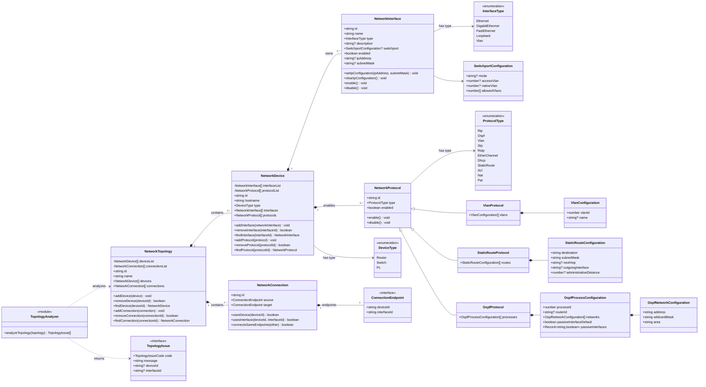

# UML-Klassendiagramm: Netzwerk-Datenmodell

Dieses Diagramm bildet H1c einschließlich der Protokollerweiterungen aus H1e ab.

## Beziehungserklärung

- Eine Topologie enthält beliebig viele Geräte und Verbindungen.
- Ein Gerät besitzt seine Interfaces und aktivierten Protokolle.
- Eine Verbindung enthält genau zwei Endpunkte.
- Ein Endpunkt verweist über IDs auf ein Gerät und eines seiner Interfaces.
- Enums begrenzen Geräte-, Interface- und Protokolltypen auf bekannte Werte.
- Der TopologyAnalyzer konsumiert das Modell und liefert strukturierte Issues.

## Konsistenzprüfung nach Implementierung

- [x] Alle dargestellten Klassen und Enums existieren im Code.
- [x] Namen und Typen der öffentlichen Eigenschaften stimmen überein.
- [x] Öffentliche Methoden stimmen mit der Implementierung überein.
- [x] Kardinalitäten entsprechen der tatsächlichen Modelllogik.
- [x] Die H1e-Protokoll- und Interface-Erweiterungen sind dargestellt.

